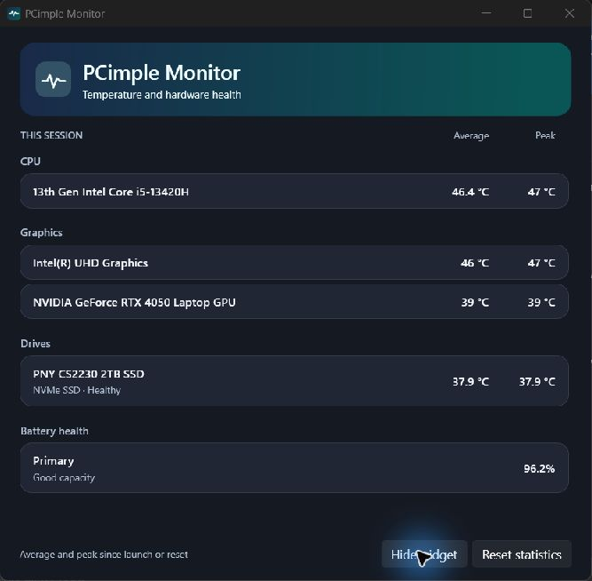
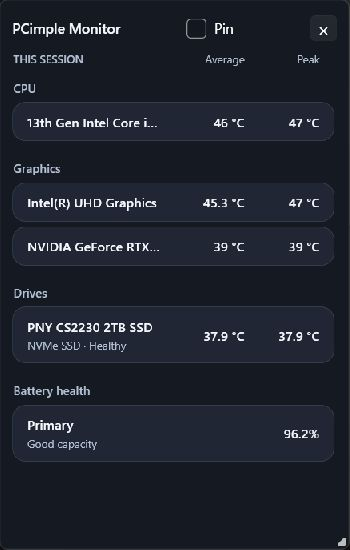

# PCimple Monitor

PCimple Monitor shows session average and peak temperatures for CPU packages, GPUs, and physical drives. It also shows drive health and battery capacity retained. Close the dashboard to keep sampling from the notification area, or open the compact desktop widget from the dashboard or tray.

## Screenshots

### Dashboard



### Desktop widget



## Install

Use the installer for your Windows architecture from [GitHub Releases](https://github.com/RmaNMetaverse/PCimple-Monitor/releases). PCimple Monitor targets Windows 10 22H2 and Windows 11. Setup installs a local sensor service and the dashboard runs as your Windows user. The x64 installer includes the official signed PawnIO setup, so compatible Intel and AMD PCs can enable CPU sensing offline. To repair a failed driver setup in version 1.0.0, run the newer x64 installer over the existing copy and keep CPU temperature sensing selected.

Sensor coverage depends on firmware, drivers, and storage controllers. On x86 and ARM64, CPU temperature is currently unavailable unless a verified package source is added for the platform. NVAPI supports native ARM64 for NVIDIA GPUs. An unavailable sensor is shown as such. Some USB and RAID controllers expose limited physical-drive health data.

On x64, Intel graphics can use Intel driver telemetry. When the driver omits it, the sensor service can read the processor's separate graphics temperature on supported Raptor Lake mobile systems with PawnIO.

## Build and test

Use the .NET 10 SDK, PowerShell, and Inno Setup 6.7 or 7.1. Run these commands from the repository root.

```powershell
dotnet run --project tests/Monitoring.Tests
.\build.ps1 -InnoCompiler 'C:\Path\To\ISCC.exe'
```

Use `-PublishOnly` to create the self-contained application and service folders without installers. Use `-Offline` after all NuGet and runtime packages have been cached. Installers and their SHA-256 checksums are written to `artifacts/installers`. For a public release, pass `-SignToolCommand` with a publisher Authenticode signing command and the Inno Setup `$f` file placeholder.

For an offline x64 build, cache the publisher's PawnIO setup at `artifacts/tools/PawnIO_setup-2.2.0.exe` or pass its location with `-PawnIOSetupPath`. The build verifies the pinned checksum and Authenticode signature before embedding it.
Cache the signed PawnIO modules archive at `artifacts/tools/PawnIO.Modules-0.2.11.zip` for offline x64 builds. The build checks the archive and Intel module against the pinned SHA-256 values.

## Publish a release

Commit and push the verified source to `origin/main` after each completed change. Build locally, tag the source commit with its version, and attach only the versioned `*-Setup.exe` files to that tag's GitHub Release. Keep the executable payloads and build output outside Git. GitHub Actions is not used for builds or releases.

## Hardware validation

For each target architecture, check install, upgrade, uninstall, standard-user launch, tray, widget, and Reset statistics. Verify the CPU package reading on Intel and AMD x64 hardware with PawnIO. Check NVMe SMART and SATA drive health against the same physical drive in a vendor utility. Confirm hybrid GPU enumeration, battery capacity, sleep/resume, and light and dark themes. Run the ARM64 package on RTX Spark before listing its sensor coverage as verified.
